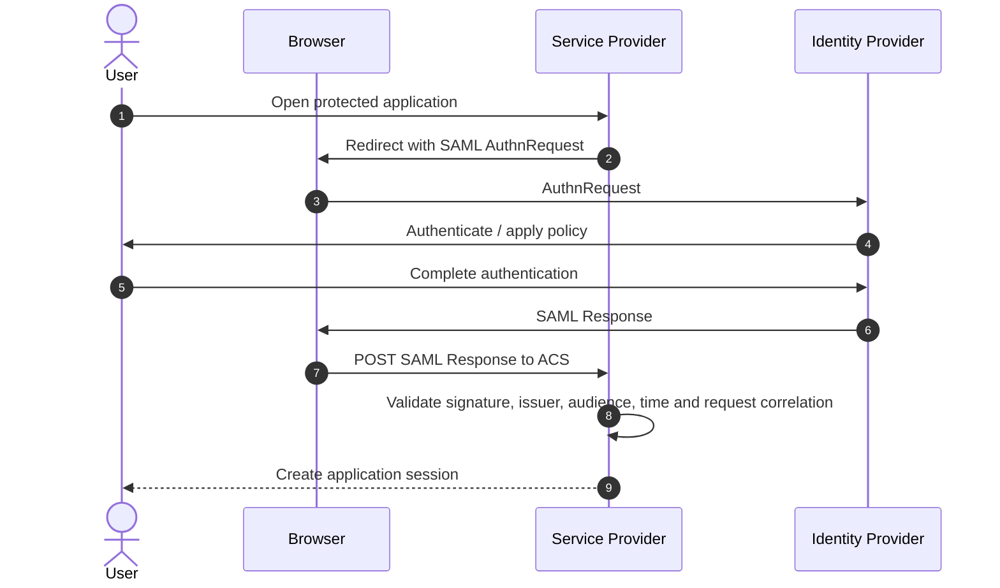
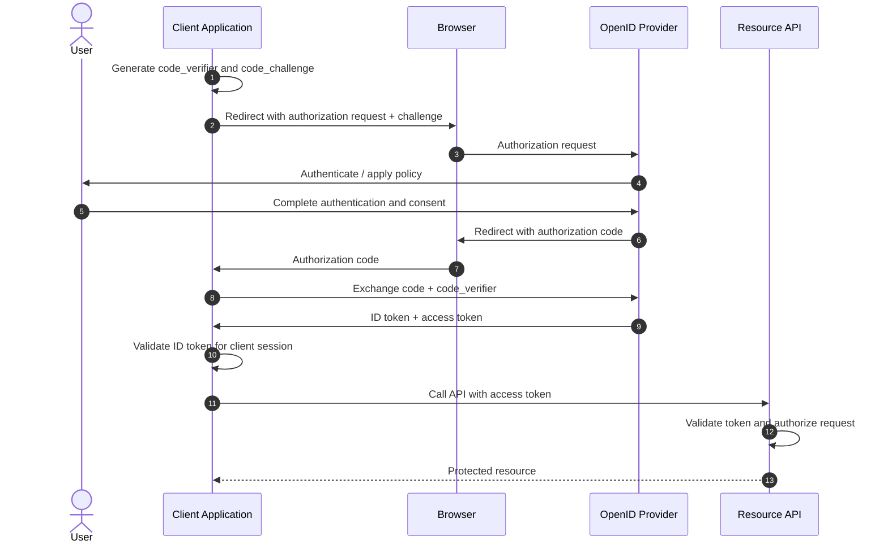
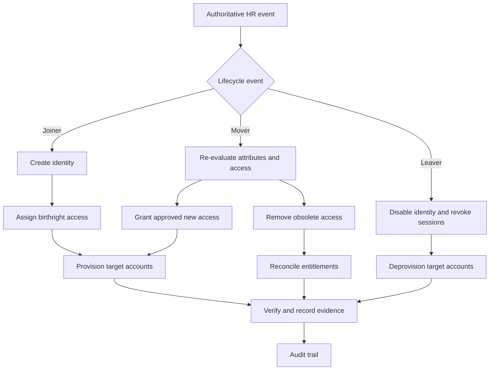

# Identity flow diagrams

These diagrams are conceptual reference flows. Validate protocol details and product-specific behaviour against the relevant implementation and current vendor documentation.

## SAML 2.0 — service-provider initiated

**Investigation checkpoints**

- Confirm whether the flow is SP-initiated or IdP-initiated.
- For SP-initiated flow, correlate the response's `InResponseTo` with the original request.
- Validate issuer, audience, recipient/destination, time conditions, signature and ACS endpoint.
- A successful HTTP response alone does not prove that the application accepted the assertion.

## OpenID Connect — authorization code with PKCE

**Investigation checkpoints**

- Verify redirect URI, state, nonce and PKCE challenge/verifier handling.
- Validate the ID token for the client: issuer, audience, signature, expiry and nonce.
- Send the access token to the intended API, not the ID token.
- The API validates its own audience and authorization requirements.

## Identity lifecycle — joiner, mover, leaver

**Architecture questions**

- Which system is authoritative for each identity attribute?
- Which platform owns account creation, group membership and deprovisioning?
- How are failed or delayed provisioning events detected and retried?
- How do you prove access was removed when a person leaves or changes roles?
